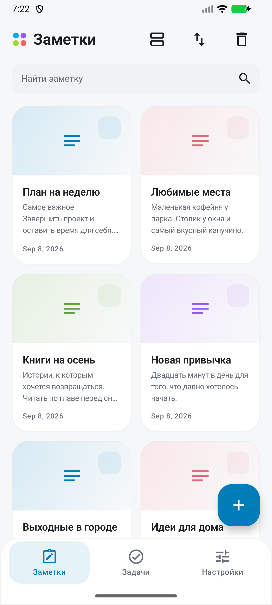
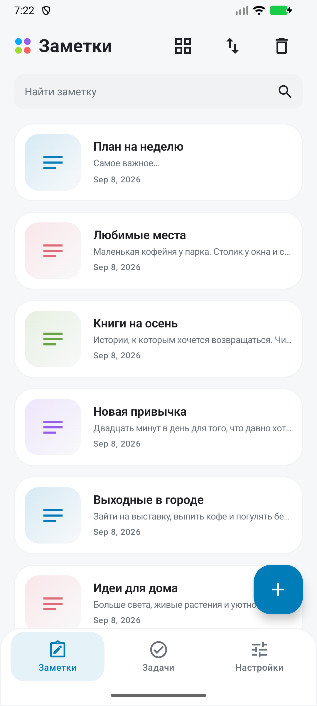
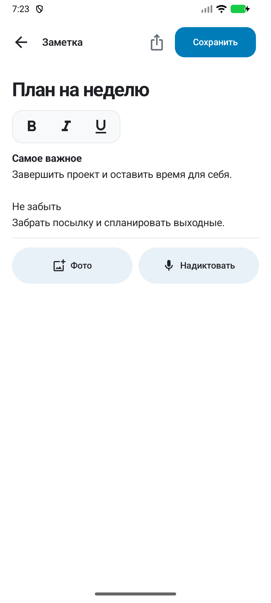
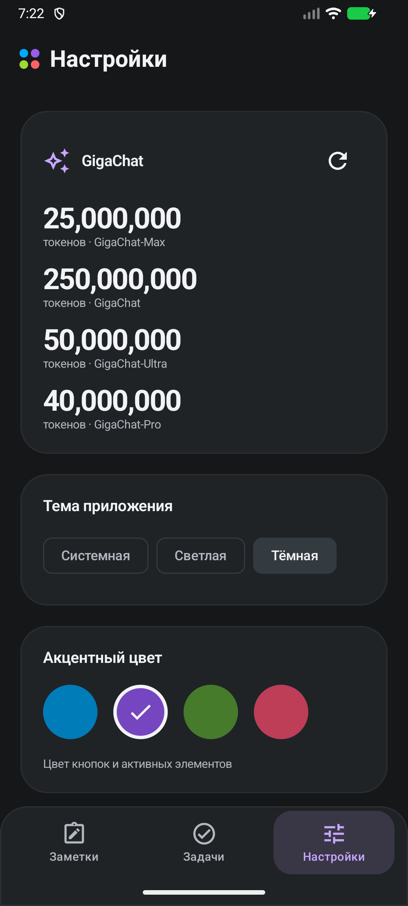
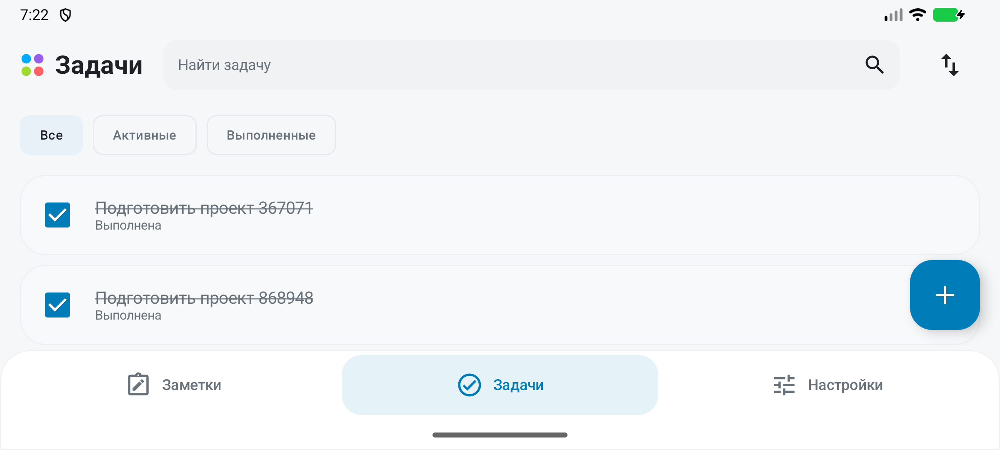

# Авито Заметки

Android-приложение для заметок и задач.
Kotlin, Jetpack Compose, MVVM и Hilt. Лёгкий интерфейс в стиле Авито: мягкие цветные обложки,
тонкие контуры карточек, выразительная типографика и компактные панели; доступны тёмная и системная темы.

Снимки работающего приложения на эмуляторе Android 16:

   

Горизонтальный режим на экране 800×360 dp:



## Запуск

1. Откройте корневую папку в Android Studio с поддержкой AGP 8.13.2.
2. Установите Android SDK Platform 36. Для запуска нужен Android 8.0 / API 26 или новее.
3. Выберите JDK 17 или JBR 21 для Gradle. Проект проверяется с JBR 21, bytecode target — 17.
4. Android Studio создаст `local.properties` с путём к SDK. Для ручной настройки есть
   [local.properties.example](local.properties.example). Не затирайте существующий `sdk.dir`.
5. Выполните Gradle Sync и запустите конфигурацию `app`.

Сборка в PowerShell из корня проекта:

```powershell
$env:JAVA_HOME = 'C:\Program Files\Android\Android Studio\jbr'
.\gradlew.bat :app:assembleDebug
```

Устанавливаемый debug APK: `app/build/outputs/apk/debug/app-debug.apk`.
Gradle Wrapper 8.14 и версии зависимостей зафиксированы в репозитории. При первой сборке нужен интернет.

## Что работает без ключей

- Создание, просмотр, редактирование и удаление заметок; обязательный заголовок, необязательный текст.
- Изображение из галереи (Photo Picker) или камеры, предпросмотр и удаление.
- Поиск по названию кнопкой или Search на клавиатуре; сортировка текущих результатов в обе стороны.
- Режим удаления блокирует открытие карточек заметок.
- Создание текстовой задачи непосредственно в списке; изменение и сохранение статуса.
- Удаление активной или выполненной задачи кнопкой корзины с подтверждением.
- Фильтры задач. Выполненные задачи всегда находятся ниже активных при любом порядке дат.
- Сохранение заметок, задач, темы и акцента между запусками.
- Мгновенное применение трёх режимов темы и четырёх акцентов; сброс оформления.
- Компактные панели, поиск рядом с заголовком на широком экране, прокручиваемые фильтры задач.
- Переключение вкладок без анимаций перехода; закрытие клавиатуры касанием вне поля ввода.
- Запрос разрешений, состояния записи, загрузки, ошибок и возможность повторить операцию.

## Дополнительные возможности

- **Форматирование:** выделите фрагмент и нажмите B, I или U. Стили можно сочетать и снимать повторным нажатием.
  Без выделения кнопки задают стиль следующего ввода. Стили сохраняются вместе с текстом и черновиком.
- **Поделиться:** кнопка в редакторе открывает системное меню Android для текущего текста и изображения.
  Передаются обычный текст, HTML и стили; итоговое отображение зависит от принимающего приложения.
- **Пагинация:** Room + Paging 3 загружают заметки порциями по 20 с подгрузкой при прокрутке и повтором при ошибке.
- **Список / сетка:** переключатель в верхней панели; выбор сохраняется в DataStore. Число колонок зависит от ширины.
  Карточки сетки резервируют две строки заголовка и две строки описания; пустое описание заменяется подсказкой.
- **Подтверждение удаления:** диалог с заголовком выбранной заметки. Отмена оставляет данные без изменений.
- **Splash Screen:** системная стартовая заставка с собственной иконкой, пока читаются настройки оформления.
  Искусственной задержки нет.

Баланс и распознавание требуют внешних сервисов. Без настроенных ключей приложение показывает
«Сервис ещё не подключён. Локальные функции доступны». Демонстрационные ответы не подставляются.

## Подключение GigaChat и SaluteSpeech

Добавьте значения локально в `local.properties` либо одноимённые переменные окружения
(переменные окружения имеют приоритет):

```properties
GIGACHAT_AUTH_KEY=base64_authorization_key
GIGACHAT_SCOPE=GIGACHAT_API_PERS
SALUTE_AUTH_KEY=base64_authorization_key
SALUTE_SCOPE=SALUTE_SPEECH_PERS
```

Здесь нужны **ключи авторизации Base64**, а не короткоживущие access tokens. Префикс `Basic ` не нужен.
Для другого типа аккаунта задайте scope, соответствующий его доступу. После изменения пересоберите приложение.

Ключи не коммитятся и не записываются в логи. В этом учебном клиенте они попадают в BuildConfig/APK,
поэтому APK с личными ключами не предназначен для публичного распространения. Для публичного приложения
авторизацию нужно перенести на свой backend. Debug APK, собранный без ключей, их не содержит.

Сервисы:

| Назначение | Запрос |
| --- | --- |
| OAuth | `POST https://ngw.devices.sberbank.ru:9443/api/v2/oauth` |
| Баланс пакетов GigaChat | `GET https://api.giga.chat/v1/balance` |
| Формулировка голосовой задачи | `POST https://api.giga.chat/v1/chat/completions` |
| Распознавание | `POST https://smartspeech.sber.ru/rest/v1/speech:recognize` |

OAuth-токены кэшируются в памяти отдельно для двух сервисов, обновляются заранее и один раз повторно
после HTTP 401. Параллельные запросы используют Mutex, чтобы не запрашивать несколько токенов одновременно.
Ошибки сети, таймаута, TLS, доступа, лимитов и некорректного ответа различаются в UI.
Баланс отображается по пакетам `usage/value`, без объединения несопоставимых пакетов.

Запись — PCM S16LE, mono, 16 kHz (`audio/x-pcm;bit=16;rate=16000`), максимум 55 секунд / 1,76 МБ.
Такой формат укладывается в ограничения синхронного распознавания. При выходе с экрана или сворачивании
запись отменяется, микрофон освобождается. Отменённая обработка не создаёт задачу.
Распознанный текст заметки добавляется к текущему тексту; задача проходит цепочку Speech → GigaChat → Room.


## Архитектура

```text
presentation/
  notes/, editor/, tasks/, settings/
    screen/                  компоновка экрана
    components/              отдельные UI-компоненты
    state/                   состояния экрана
    viewmodel/               события и операции MVVM
  common/                    components, state, text, input, media, voice
  theme/                     палитры и тема
navigation/                  вкладки и корневой экран
domain/
  model/, repository/, usecase/
data/
  local/                     dao, entity, database, repository, media
  remote/                    api, dto, client, auth, error, repository
  audio/                     Android AudioRecord
di/                          Hilt-модули
```

Один Gradle-модуль с разделением по слоям: domain не зависит от Android UI, Context и реализаций хранения.
Контракт страниц использует `PagingData`, а правила редактирования текста остаются чистым Kotlin.
Hilt создаёт зависимости через `@HiltAndroidApp`, `@AndroidEntryPoint` и `@HiltViewModel`.
Room, DataStore и сетевые репозитории имеют scope приложения; AudioRecord — scope ViewModel.
ViewModel получает интерфейсы репозиториев через конструктор. Domain не зависит от Hilt.
Модели, UIState, DTO и интерфейсы находятся в отдельных файлах. `ApiClient` отвечает за конфигурацию
OkHttp/JSON/Retrofit, `ApiEndpoints` — за базовые адреса, Hilt-модули — за создание и связывание объектов.
ViewModel владеет состоянием и операциями; Compose отображает состояние и передаёт события.
Room Flow/Paging автоматически обновляют списки. DataStore хранит тему, акцент и вид заметок.
SavedStateHandle сохраняет текст и стили черновика редактора, а также введённый поиск.
Пользовательские строки и описания доступности вынесены в `res/values/strings.xml`.
ViewModel передаёт ошибки как `UiText`, а UI разрешает ресурс в строку текущей конфигурации.

Поиск заметок выполняется в SQLite по нормализованному `searchTitle` (`Locale.ROOT`), поэтому поддерживает
кириллицу и буквальные символы `%`/`_`. Фильтрация и сортировка выполняются до разбиения на страницы;
`id` определяет стабильный порядок при одинаковой дате. Запрос применяется только при явной отправке.
Задачи используют domain-селектор с `ignoreCase` и приоритетом активных задач.

Room schema 2 добавляет JSON-диапазоны форматирования, `searchTitle` и индекс даты/ID.
Миграция 1 → 2 сохраняет существующие заметки и задачи, заполняет нормализованные заголовки.
Разметка хранит UTF-16 диапазоны с исключённой правой границей; domain-правила пересчитывают их при правках.

Изображения копируются в приватный `filesDir/note-images`: заметка не зависит от дальнейшей доступности
исходного URI. Принимаются декодируемые изображения до 20 МБ. Удаление проверяет принадлежность файла
директории приложения; старое изображение удаляется после успешного изменения записи в Room.
Photo Picker ограничивает выбор изображениями. Если он недоступен, открывается галерея через `ACTION_PICK`,
без перехода в общий файловый браузер. Широкое разрешение на хранилище не требуется.
Камера получает временный URI из `cache/camera`. Для отправки изображения FileProvider дополнительно
открывает только `files/note-images`; получатель получает временное разрешение на чтение конкретного URI.
Тип изображения определяется по содержимому, даже если приватная копия имеет расширение `.image`.

Coil отвечает за декодирование и загрузку превью с учётом размера UI. Остальные библиотеки реализуют
требуемые инфраструктурные компоненты: Room, DataStore, Navigation, Retrofit/OkHttp, kotlinx.serialization.

Режим «Системная» следует светлой/тёмной теме Android. Палитры приложения, включая поверхности панелей,
фиксированы и не используют цвета обоев; принудительное затемнение Android отключено.

Стиль Kotlin закреплён в `.editorconfig`: четыре пробела, ограничение строки 120 символами,
переносы аргументов и завершающие запятые. Проверка: `:app:ktlintCheck`; форматирование: `:app:ktlintFormat`.

## TLS и источники API

Проверка HTTPS и hostname включена. Для трёх указанных доменов Network Security Config дополнительно
доверяет публичному Russian Trusted Root CA; для остальных действует только системное хранилище.
Сертификат не устанавливается в ОС и не содержит приватного ключа.

- [Документация сертификатов GigaChat](https://developers.sber.ru/docs/ru/gigachat/certificates)
- [Источник PEM](https://gu-st.ru/content/lending/russian_trusted_root_ca_pem.crt)
- SHA-256 DER-сертификата: `D26D2D0231B7C39F92CC738512BA54103519E4405D68B5BD703E9788CA8ECF31`
- SHA-256 файла PEM в репозитории: `936A43FEA6E8E525BCC0F81ACD9C3D21B4FC4B9B68ACEA7906D698005AFC6504`
- Срок действия сертификата: 02.03.2022–28.02.2032.
- [GigaChat REST](https://developers.sber.ru/docs/ru/gigachat/api/reference/rest/gigachat-api),
  [balance](https://developers.sber.ru/docs/ru/gigachat/api/reference/rest/get-balance),
  [chat](https://developers.sber.ru/docs/ru/gigachat/api/reference/rest/post-chat).
- [SaluteSpeech sync](https://developers.sber.ru/docs/ru/salutespeech/rest/sync-general),
  [форматы аудио](https://developers.sber.ru/docs/ru/salutespeech/guides/recognition/encodings).
